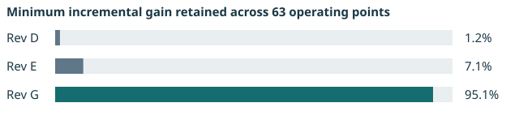
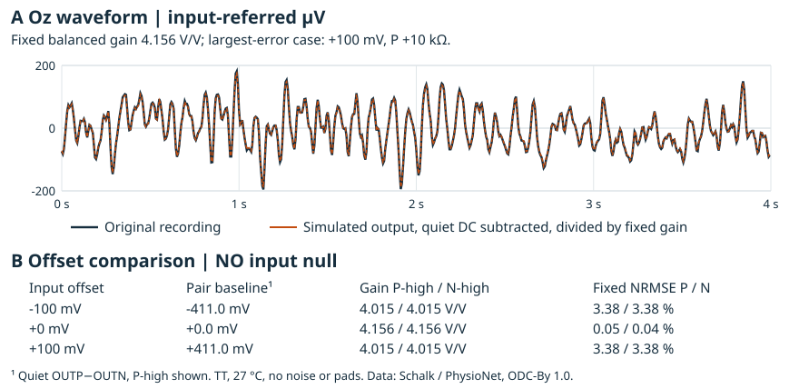

# Experimental evidence: where this design earns its slot

**Evidence level:** Sky130A transistor-level schematic simulations, not measured silicon or layout extraction. Revision G retains useful incremental gain under electrode offset. Input impedance, noise and rejection still have to survive real pads, the bias adapter and the measurement buffers.

## Recorded EEG, rather than a sine wave alone

For comparison with the [Challenge #2 biosignal amplifier](https://github.com/orpheus016/sg13cmos5l_spma_ip__instramp/blob/032fcfca79c82cba84269662a915b4293ce339d0/docs/biosignal/README.md), use the **same** four-second, 640-sample, 160 Hz eyes-closed recording (Oz; S001, run 02, 10–14 s). The previous team tested programmable high gain with a deliberate input-offset null. Our different question is whether an un-nulled, differential ±100 mV offset leaves the low-gain stage able to reproduce the smaller waveform. The designs use different processes, loads and gain ranges; this is not a performance ranking.

Inject the public EEG as a piecewise-linear voltage on top of a fixed DC offset. Use 10 kΩ on both inputs for the reference case; then 20/10 kΩ and 10/20 kΩ at −100, 0 and +100 mV. Use **one gain calibration** from the balanced zero-offset case for every waveform. For analysis only, subtract the quiet differential output observed before each playback. That subtraction is not a DC servo; absolute output levels remain relevant to clipping. Correlation alone can hide gain compression, so report fixed-calibration RMS error as well. No transient noise, pads, or active readout in this replay.

**Result:** all seven TT, 27 °C replays completed. On a 377 µV peak-to-peak recording, the worst fixed-calibration error was **3.38% RMS** (2.11 µV RMS input-equivalent). Fitted gain dropped from 4.156 V/V at the balanced reference to 4.015 V/V under ±100 mV offset. No sampled output entered the 50 mV rail guard (0 of 4,480 sample instants); the quiet differential output itself shifted by about ±411 mV. The waveform shape survived, but the modest gain loss is real. This does not characterize changes in electrode offset during a recording, transient noise, or silicon. [All seven results and separate offset-step observations](evidence/replay/metrics.json).

## Will ordinary bench loads erase the signal?

A separate nominal small-signal simulation replaced each output termination with a matched resistive/capacitive model of a high-impedance instrument. Results include the real Rev G transistors, matched 10 kΩ sources, a quiet 1.65 V reference, zero electrode offset and **no** pad, protection, cable model beyond the specified lumped capacitance, or instrument noise.

| Per-output termination | Output common mode | Differential gain at 10 Hz |
|---|---:|---:|
| 4.915 MΩ ∥ 0.1 pF to VCM (core comparison) | 2.704 V | 4.156 V/V |
| 10 MΩ ∥ 15 pF to ground | 2.703 V | 4.171 V/V |
| 1 MΩ ∥ 20 pF to ground | 2.621 V | 4.044 V/V |

Resistive loading alone did not extinguish the signal in these three cases. A 10 µV differential input still gives only about 41 µV output, and the operating point moved by 84 mV with the heavier load. The predicted nominal core noise corresponds to only 2.38 µV RMS at its output over 0.5–45 Hz. A useful **readout design budget**, not a measurement, is ≤0.5 µV RMS additional differential readout noise over that band (about 2.2% increase in total RMS if independent). Characterize buffer, fixture and recorder noise and conversion of common-mode signals before interpreting a measured EEG waveform. [Load results](evidence/readout-load.json).

**Reproduction.** In the pinned [EDA environment](../REPRODUCE.md), run `eda python3 tools/replay_eeg.py --out build/replay --jobs 4` and `eda python3 tools/probe_loading.py`. The replay also runs a separate balanced-source power-up/offset-step bench. The [fixture manifest](../afe/replay/attribution.json) pins the source revision and checksum. The open [stress](../afe/runs/hiz-stress-g/metrics.json) and [mismatch](../afe/runs/hiz-mismatch-g/metrics.json) summaries record independent model sweeps.

**Data credit.** G. Schalk, *EEG Motor Movement/Imagery Dataset*, version 1.0.0, PhysioNet, [doi:10.13026/C28G6P](https://doi.org/10.13026/C28G6P), [ODC-By 1.0](https://opendatacommons.org/licenses/by/1-0/). The previous amplifier team converted the excerpt to volts, removed its mean and reset its time origin; its CSV is redistributed unchanged. The source waveforms are open research recordings; there is no live human connection or claim about the source of measurements on the proposed IC.
