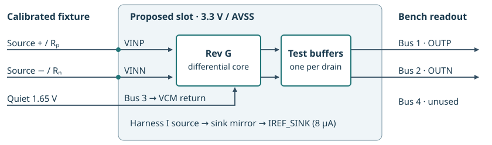

## Silicon measurement plan

**Question (§6.5):** Does a packaged channel still amplify a small differential signal when its two synthetic electrodes differ by 100 mV DC? Measure at the package pins; an isolated-core simulation is not a substitute. No body connection or stimulation.

### Wiring and calibration

Use two dedicated 3.3 V analog pads for VINP and VINN. Select only this slot on the shared analog mux: two lines for separately buffered OUTP and OUTN, one **input** for a quiet external 1.65 V core bias-return reference (VCM); the fourth is unused. Bus numbers in the figure are logical, not assigned package pins. Supply AVDD at 3.3 V nominal relative to AVSS. One harness reference **sources** current into a proposed on-chip NMOS mirror; its output **sinks** 8 µA nominal from IREF_SINK toward AVSS. Do not drive that node with a sourcing reference. Mirror ratio/compliance, pad selection, buffer swing and bus loading are integration gates, not demonstrated features.

The isolated bench uses 4.915 MΩ ∥ 100 fF from **each drain** to VCM and predicts about 2.70 V output common mode. This is a receiver surrogate, **not** a package termination. Characterize the actual buffer input admittance, output headroom, stability and noise with extracted mux/package and intended cable/recorder load. Use high-impedance readout, not 50 Ω termination. Measure both outputs simultaneously; retain both DC levels as well as their difference.

**Required capabilities:** shielded, guarded fixture with switchable calibrated resistors; low-noise differential/DC source and common-mode drive; low-noise supply/reference and current metering; guarded picoammeter or electrometer; two synchronous DC-coupled low-noise acquisition channels with anti-alias filtering and transient capture; temperature-controlled fixture. **Availability:** no equipment access is asserted here. An actual equipment inventory belongs in the separate §6.6 submission.

Before inserting a die, characterize the source amplitudes, source resistances, fixture leakage/admittance and readout gain/phase on both paths. Use matched through connections, then a common drive at the expected output bias to measure the readout's differential residual at 50/60 Hz. Short the recorder inputs to a quiet source of representative impedance to measure its noise floor. Shield cables, use a single analog return and keep digital lines static after mux selection. Repeat calibration after lead swaps and temperature changes. Retain the raw package result; correct only independently measured fixture/readout errors, not real pad, buffer or mux effects.

### Measurement sequence

1. **Startup and power.** With matched 10 kΩ sources tracking VCM, ramp from unpowered through the permitted harness sequence, never back-driving unpowered pads. Record rail, VCM, bias timing, outputs and supply current through settling; repeat after discharge with slow and fast legal ramps. Record settled differential offset and output common mode. Report rail voltage × current at idle and driven, including wrapper/buffers. Compare with a harness-only baseline only if independently isolatable; otherwise label total slot/harness power, not core power.
2. **Gain retention and clipping.** Hold VCM at 1.65 V; independently set source common mode to 1.20, 1.65 and 2.10 V. Split each −100, 0 and +100 mV DC differential offset equally and oppositely about that common mode. Superpose a calibrated 1 mV-peak differential sine at 10 Hz. Fit the differential output fundamental; divide by differential source amplitude. Repeat with an extra 10 kΩ on P, then on N, against matched low source impedances. Report absolute gain and the **minimum ratio to zero-offset gain at 1.65 V** on the same die, rail, temperature and resistor orientation. Plot both output levels and distortion versus drive; increase the tone within approved operating limits and locate 1% gain compression or report the largest unclipped amplitude tested.
3. **Noise.** At zero offset, terminate both inputs locally to the same quiet 1.65 V through matched low resistances. Acquire at ≥500 samples/s with analog anti-aliasing for ≥120 s after settling. Estimate one-sided differential output PSD with windowed, overlapping segments at ≤0.1 Hz bin spacing. Divide each bin by measured differential gain magnitude squared at that frequency, integrate **0.5–45 Hz**, and take the square root. Publish the spectrum, RMS, bandwidth and readout floor without a mains notch. The measured result includes pads, reference and buffers; if floor-limited, quote an upper bound, not a core noise figure.
4. **Input impedance and DC current.** At 10 Hz, bias both legs at 1.65 V; drive a small differential tone through a calibrated large series resistor on each leg. Use guarded, high-impedance voltage sensing at each socket node; infer complex currents from resistor drops and compute $Z_d=(V_P-V_N)/[(I_P-I_N)/2]$ with currents positive into the package. Use an empty socket with identical cabling/probes to characterize complex shunt currents at the same node voltages; subtract those currents, not impedance magnitudes. Verify the method with a known high-value differential R∥C standard. Keep pads/ESD in the reported result. At room temperature record each leg's settled DC current over the gain-test bias grid; subtract independently measured fixture leakage and report the residual uncertainty.
5. **Imbalanced CMRR.** Use one common-mode source split to both legs at 1.65 V DC; drive a 100 mV-peak common tone, separately at 50 and 60 Hz. Measure coherent differential output and normalize to the common source amplitude to get $A_{cm}$. Measure $A_d$ with a differential tone at the **same frequency and resistor setting**. Report $20\log_{10}|A_d/A_{cm}|$ for extra 10 kΩ on P and on N (all four values and the minimum). Check with drive off and reversed acquisition channels; bound residual source imbalance, pickup and readout conversion. Quote a lower bound if the residual cannot be resolved.
6. **Offset recovery.** With matched 10 kΩ legs, apply +100 mV differential for 2 ms, return to zero, then repeat at −100 mV (0.1 ms edges). Record residual relative to the pre-step baseline at 1.8 ms after return and time to re-enter and stay within the measured baseline noise band (state band and observation window). Apply a subsequent +5 mV differential step to verify gain returns; retain individual outputs to distinguish clipping from a common-mode shift.

Record die identifier, sample count, temperature, rail, bias setup, loads, calibration and uncertainty with every result. Compare against the proposal targets per die, then report range, typical and worst case across available dies and approved rail/temperature points; an uncertainty interval straddling a limit is inconclusive. Before tapeout, verify the reusable standalone layout and its separately integrated slot wrapper with open DRC/LVS, extraction and post-layout PVT, mismatch and startup checks. Include pad leakage/capacitance, buffer mismatch, source-to-sink bias and shared-bus loading before committing to a package measurement margin.
