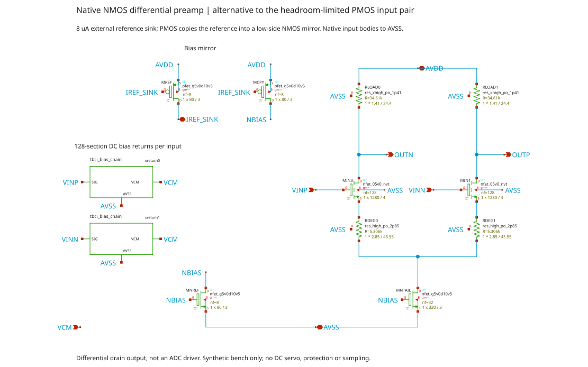

# A Sky130 EEG preamplifier that preserves gain under electrode offset

**Chipalooza Challenge #4 (Chip Foundry Sky130) · Proposal · 23 November 2026**

**Request:** fabricate one continuous-time, differential-input/differential-output analog preamplifier and its test wrapper. The question for silicon is whether a small EEG-band signal remains measurable when a much larger DC voltage separates the two inputs. The proposed test is a calibrated 10 Hz tone superposed on up to ±100 mV differential DC, with independent control of input common mode. The transistor-level Rev G core exists. Its protected inputs, monitor buffers, harness bias adapter and layouts do not yet exist.

**Why fabricate it?** In seven transistor-level replays of the same recorded EEG excerpt, the worst fixed-gain waveform error was 3.38% RMS after subtracting the quiet output baseline. The circuit was not retuned for electrode offset. The open question is whether that signal survives pad leakage, buffer noise and package loading.

## Function and place in a system

A sensor-interface SoC could use this stage **before** level translation, offset removal, further gain, filtering and digitization. The deliberately modest gain leaves room for DC offset: at nominal bias a +100 mV differential offset produces about +0.41 V differential output, rather than being cancelled. The next stage must accept that swing about a high output common mode (2.70 V nominal); it cannot be a directly connected 1.8 V ADC. There is no servo, PGA, sampler, digital interface or multi-channel bank in this proposal. The test ports expose raw analog voltages; the block does not enforce privacy. All tests use electrical sources, either generated signals or playback of a public recording; no human or animal connection, stimulation, diagnostic use or patient-safety claim.

Each input drives a large native NMOS gate and returns to a quiet 1.65 V reference through 128 series sections of high-resistance polysilicon. The resistor strings establish a DC path without a clock or switched input. Each input transistor has 128 fingers, 10 µm wide by 4 µm long per finger. Source degeneration trades gain for linear range; two drain resistors convert the steered current to voltage. The outputs are named so increasing VINP relative to VINN increases OUTP relative to OUTN. The core's diode-connected PMOS bias leg requires a current **withdrawn** from `IREF_SINK`; its PMOS copy drives the NMOS tail mirror. No bias generator is implicit in the core.

{width=100%}

## External resources and test ports

Standalone core pin order: `AVDD AVSS VCM IREF_SINK VINP VINN OUTP OUTN`. The following are **requested logical connections**, not assigned package pin numbers.

| Core connection | Direction at core | Proposed Challenge #4 connection and reason |
|---------------|-----------------|--------------------------------------------------------------|
| VINP, VINN | Analog inputs | Request one dedicated 3.3 V analog pad for each input; no shared input mux. Match routing, capacitance and leakage. Use standard protected pads; retain ESD structures in the model and measurement. Physical pad numbers are unassigned. |
| OUTP, OUTN | Analog outputs | High-impedance drains, **not** pad drivers. Two planned high-input-impedance, nominally unity-gain buffers feed shared analog lines 1 and 2 through the harness mux. Read both simultaneously; no external drive or 50 Ω termination. |
| VCM | Analog reference input | Shared analog line 3, driven from a quiet, low-impedance external 1.65 V source while this slot is selected. Keep it fixed when sweeping the two signal inputs together. Confirm bidirectional bus routing, noise and settling; do not assume the on-chip voltage reference provides 1.65 V. |
| IREF_SINK | Bias port; current exits core | Request **one sourced** harness reference. Feed a diode-connected NMOS in the wrapper; its scaled NMOS mirror pulls 8 µA nominal from the core port toward AVSS. Set the mirror ratio only after confirmation of delivered current, compliance and startup. No external bias pin and no direct source-to-source connection. |
| AVDD, AVSS | Supply, return | 3.3 V analog domain. No 1.8 V signal enters the core. Use the harness's slot power and mux selection, not new project control pins. |

Total: **2 dedicated pads, 3 shared analog lines, 1 current source, 0 project digital controls/status pins**. Shared line 4, dedicated pad 3 and the second reference current are not requested. Final resource values and slot dimensions are organizer dependencies, not properties inferred from a different shuttle.

## Proposed operating and performance specifications

Voltages are relative to AVSS. Proposed extracted-core verification conditions (low / nominal / high): AVDD **3.135 / 3.300 / 3.465 V**; temperature **−40 / 27 / +110 °C**; input mean **1.20 / 1.65 / 2.10 V**; differential DC **−100 / 0 / +100 mV**. The bias-return pin is held at 1.65 V and the nominal core sink is 8 µA. Use TT, SS, FF, SF and FS crossed with the three rails and temperatures; repeat the nine input operating points for gain retention. Test actual reference tolerance/compliance separately; ideal bias alone cannot qualify the wrapper. This grid is a **plan**, not the set already passed.

| Characteristic | Min goal | Nominal design point | Max goal | Port and condition |
|---------------------|-------:|----------------:|-------:|--------------------------------------|
| Differential gain, V/V | 3.0 | 4.16 | 5.5 | Core and buffered package; 10 Hz, zero offset |
| Incremental gain / baseline | 0.90 | 1 at baseline | — | Core and package; all nine mean/offset points; normalized to same condition at 1.65 V mean, zero offset |
| Differential input impedance, MΩ | 100 | 1,179 | — | Across the input pair, 10 Hz, zero offset |
| Input-referred noise, µV RMS | — | 0.572 | 1.0 | Differential, integrated 0.5–45 Hz, matched low-impedance sources, zero offset |
| Imbalanced CMRR, dB | 80 | 89.9 | — | Worst of 50 and 60 Hz, extra 10 kΩ on either leg, zero offset |
| Absolute DC input current per leg, nA | — | 0.795 worst on nominal grid | 5 | At each mean/offset point; include pad leakage at package |
| Core idle supply current, µA | — | 50.6 | 65 | Including core reference leg, not the wrapper or harness; 167 µW nominal |

Nominal entries are **isolated-core model values**, not package predictions or population averages. A dash means no specification in that direction. Min/max are proposed acceptance thresholds: verify the **core** across the stated extracted model grid with its defined surrogate load (4.915 MΩ in parallel with 100 fF per drain to VCM). The first six rows also apply as **separate pad-to-buffer goals** at 27 °C, 3.3 V, using the selected slot, actual pads, reference and high-impedance recorder. Characterize the wrapper across the full grid and publish degradation; do not extrapolate the room-temperature pad limits to hot silicon. At the package, retention uses a 1 mV-peak differential tone at 10 Hz and is checked with 10 kΩ imbalance on either leg as well. No measured pad-level value or total slot power is available. The 0.5–45 Hz interval defines the noise integral, not −3 dB bandwidth; measure gain versus frequency, absolute output offset, output common mode and recovery separately.

**Absolute no-exceed instructions for planned testing, not damage ratings:** keep external analog pins between AVSS and the instantaneous powered AVDD; never drive pads on an unpowered slot, drive a monitor output, or inject clamp current deliberately. Do not exceed 3.465 V AVDD, +110 °C, 2.10 V input mean or ±100 mV differential DC in the proposed steady-state tests; the gain probe adds at most ±1 mV differential about a DC endpoint. Use the lower limit wherever final harness, package, PDK or fixture restrictions are tighter. Start at 3.3 V and room temperature. Destructive pin-voltage/current, short-circuit, ESD withstand, storage and junction-temperature ratings of the integrated macro are **unknown**. A SPICE corner or the name of a transistor model does not establish one.

## Evidence, comparison and risks to closure

Seven selected matched-device process/rail/temperature combinations gave 3.33–5.06 V/V gain, 1.062–1.302 GΩ differential input impedance and 0.482–0.676 µV RMS noise. At all 63 mean/offset points, the centered ±1 mV DC slope retained at least 95.1% of that condition's nominal 10 Hz gain. Earlier revisions reached only 1.2% (PMOS D) and 7.1% (native NMOS E) at their worst points. This is the reason to fabricate the lower-gain, degenerated design. Separately, eight nominal-corner local-mismatch draws produced minimum imbalanced CMRR of 84.64 dB and zero-input differential output offsets from −7.06 to +10.92 mV. These small, separate screens are not a crossed PVT/mismatch analysis or a yield estimate. One nominal power-ramp simulation responded to a +5 mV differential step after excursions of both polarities; it does not establish a worst-case startup or recovery time.

Two comparisons delimit the claim. In a like-process schematic test, the two input shunts of the earlier [Challenge #1 instrumentation amplifier](https://github.com/fossi-foundation/sky130_pa_ip__instramp) alone gave 9.83 MΩ differential at 10 Hz. Rev G's longer physical returns address that loading; this is not a comparison against measured silicon. A mature integrated EEG device, the [TI ADS1299](https://www.ti.com/lit/ds/symlink/ads1299.pdf), couples eight PGAs to simultaneous 24-bit ADCs and specifies 1 µV peak-to-peak input noise in 70 Hz bandwidth. Rev G is one open analog stage. Neither its integrated RMS noise in a different band nor its simulated CMRR establishes parity with a packaged converter.

Three issues decide whether the core will be useful after packaging:

- **Pad leakage and source imbalance:** model both pad orientations, input-return parasitics, ESD and hot leakage; test input impedance, leg current and imbalanced CMRR at the dedicated pads. Report a floor-limited measurement as a bound, not a pass.
- **Output swing and bias compliance:** the individual drains ranged from 2.23 to 3.09 V on the 63-point grid. Prove that neither monitor clips over the actual rail/offset combinations, and that its noise, mismatch and input admittance leave margin. Include mux, shared-bus and recorder loading and harness reference startup in transient tests; never connect a drain directly to the bus.
- **Area and matching:** the 256 return resistors alone occupy 0.0771 mm² of resistor body, before spacing, folding or routing. Floorplan these first with matched input devices and resistor pairs; extract coupling and distributed capacitance including fill. If the compact layout cannot fit the assigned slot or misses a limit, bring the evidence to review for redesign or an approved specification change. Do not waive the failing case.

## Review gates and fabrication deliverables

| Gate | Deliverable and release decision |
|-----------------------|--------------------------------------------------------------|
| Week of 23 Nov 2026: proposal | Freeze the one-channel contract, confirm availability of both dedicated analog pads and external VCM path, request current-source value/compliance and slot outline. |
| By week of 28 Dec 2026: schematic review | Release Xschem core and wrapper, bias adapter and monitor schematics, device/loading budget and estimated area. Demonstrate startup, noise, gain retention and CMRR with pad models, reference tolerances and swept load. Resolve or flag every missed limit before layout. |
| By week of 1 Feb 2027: standalone layout review | Deliver editable standalone layout, extracted netlist, GDS and integration abstract; clean DRC and matching LVS. Compare extracted results against schematic over the stated PVT grid. Sweep mismatch with more samples, report count, seeds and worst margins; check voltage stress, rail sequencing and recovery. |
| By week of 22 Feb 2027: final review | Deliver the separate integrated slot layout, pin/pad configuration, wrapper GDS/abstract, DRC/LVS and post-layout results including mux/load assumptions. Publish sign-off summaries, plots, versioned tool/PDK setup and scripts that regenerate raw results from source without proprietary tools or AI. Mark unresolved failures explicitly; request tapeout only with accepted closure. |
| Top-level integration to 19 May 2027; after packaged parts arrive | Support harness assembly and final connectivity checks against the tagged release. Measure the packaged path with synthetic inputs per the [silicon measurement plan](measurement.md); publish calibrated spectra, transfer curves, offsets, uncertainty and failures alongside simulated curves. Packaging and measurement dates are not assigned. |

Deliver both reusable core and harness-specific views in a public, open-licensed repository with behavioral and pin documentation, source schematics/layout, regenerable SPICE and abstraction views, license notices and reproducible open-tool sign-off. The separate evidence and measurement chapters define what has run and how silicon will be judged. Administrative attachments are not part of this anonymous document.

**Challenge sources:** [Rules and resource limits](https://opencircuitdesign.com/chipalooza/rules-4.html); [official review and tapeout schedule](https://opencircuitdesign.com/chipalooza/schedule-4.html); [current status of the Sky130 harness](https://opencircuitdesign.com/chipalooza/challenge-4.html).
